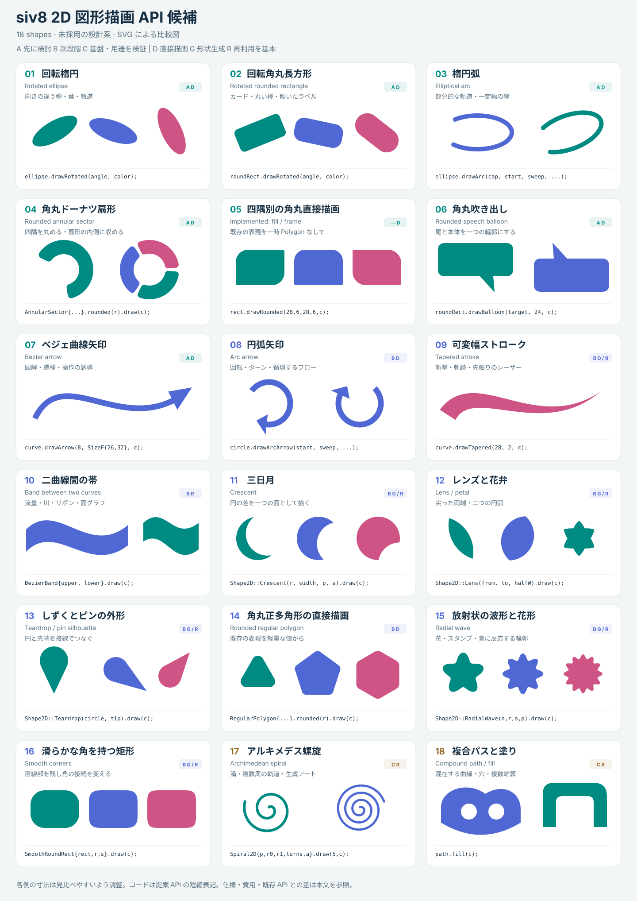
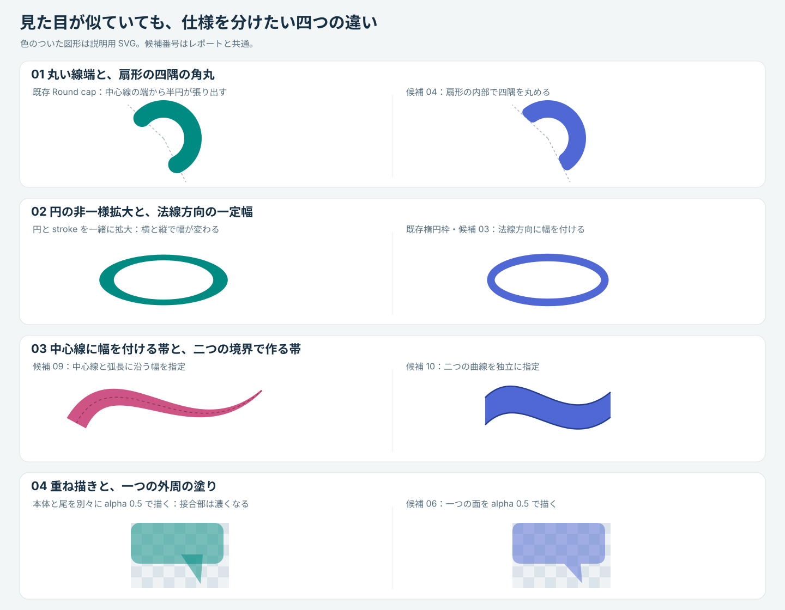

# siv8 の 2D 図形描画を広げる API 提案

状態: 未採用の候補を検討する調査・設計提案。01 回転楕円と 03 楕円弧は実装済みで、仕様と作例は [Renderer2D ガイド](../../renderer2d/README.md#rotated-ellipses-and-arc-ends)に集約する。07 ベジェ曲線矢印も実装済みで、[曲線描画ガイド](../bezier-drawing.md#curved-arrows)に集約する。05 四隅別の角丸直接描画も実装済みで、[角丸描画ガイド](../rounded-drawing.md#independent-corner-rectangles)に集約する。08 円弧矢印も実装済みで、[曲線描画ガイド](../bezier-drawing.md#circle-arc-arrows)に集約する。06 角丸吹き出しも実装済みで、[角丸描画ガイド](../rounded-drawing.md#rounded-speech-balloons)に集約する。11 三日月・12 レンズ・13 しずくも実装済みで、[円から作る図形のガイド](../circular-shapes.md)に集約する。残る候補の採用は未定。

私の推奨は、**まず既存図形の回転・部分描画・角の指定を安価にし、次に曲線を矢印や帯として扱えるようにする**ことである。その後に、三日月・レンズ・しずく・花形のように、少数のパラメータから多くの表現を作れる形を加える。図形名を増やすだけでなく、「向き」「切り出す範囲」「接続」「幅」を指定できることが、ゲーム、UI、図解に共通して効く。

12 レンズ・花弁は Shape2D factory として実装済み。残る候補には 02 回転角丸長方形と 04 角丸ドーナツ扇形がある。09 可変幅ストロークと 10 二曲線間の帯は表現力が大きいが、自己交差や分割品質まで含む設計が必要なので別段階にする。

## SVG で比較する

- [18 候補の図形ギャラリー](shape-drawing-gallery.svg)。番号は本文と対応する。各カードには形の変種と API の短縮表記を添えた。
- [仕様の違いを比較する図](shape-drawing-semantics.svg)。丸い線端と四隅の角丸、楕円の太さ、帯の定義、半透明の接続を比較する。



SVG は提案する幾何の説明図であり、siv8 の描画結果ではない。作例は独自に作成した。SVG のストロークやパスを利用しているため、siv8 での AA、分割品質、半透明の結果を保証するものではない。

実装済みの 01・03・05・06・07・08・11・12・13 は比較用に番号を残している。それ以外の「提案 API」は未実装で、宣言は主要な引数だけを示す。色変数 `c`、座標、曲線などは呼び出し側で用意する。「1 行」は一つの描画式を意味し、初期化や複数の文を同じ行へ詰めることは数えない。

## 現在の API でできること

公開ヘッダと対応する実装を確認すると、追加を考える前に除外すべき候補がかなりある。

| 表現 | 現在の手段 | 追加検討の余地 |
|---|---|---|
| 円環、扇形、丸い端の円弧、弓形 | [`Circle`](../../../Siv3D/include/Siv3D/Circle.hpp) の `drawFrame`、`drawPie`、`drawArc(LineCap, ...)`、`drawSegment` | 普通のドーナツや半円を新設する必要はない。四隅を丸めた扇形は別 |
| 楕円、楕円枠、楕円扇形、回転楕円、楕円弧 | [`Ellipse`](../../../Siv3D/include/Siv3D/Ellipse.hpp) の `drawRotated`、`drawFrameRotated`、`drawArc` など | 回転した楕円弧は `Transformer2D` と併用できる |
| 四隅別の角丸、面取り | [`RectF`](../../../Siv3D/include/Siv3D/RectF.hpp) / [`Rect`](../../../Siv3D/include/Siv3D/Rect.hpp) の `drawRounded`、`drawRoundedFrame`、`rounded(tl, tr, br, bl)`、`chamfered` | 四隅別の角丸の塗り・枠は直接描画に対応 |
| 台形、平行四辺形、ひし形 | `trapezoid`、`shearedX/Y`、`skewedX/Y`、`inscribedDiamond` | `Quad` を返せるので追加の優先度は低い |
| V 字の突起・切り欠き、階段状の角、円形の角の切り欠き | `RectF::pointed`、`stepped`、`scooped` | 「チケット風の角」「旗の端」を一律に未対応と扱わない |
| 角丸三角形・四角形・星・多角形 | [`Triangle`](../../../Siv3D/include/Siv3D/Triangle.hpp)、[`Quad`](../../../Siv3D/include/Siv3D/Quad.hpp)、[`Shape2D`](../../../Siv3D/include/Siv3D/Shape2D.hpp) の `rounded` | 既存の表現。毎フレーム生成を避ける入口や滑らかな角への拡張を評価 |
| ハート、星、十字、直線矢印、吹き出し、アステロイド | `Shape2D` の各 factory、[`Line::drawArrow`](../../../Siv3D/include/Siv3D/Line.hpp) | 名前だけの重複追加は不要。曲線矢印、角丸吹き出しは差分がある |
| カプセル | `Line::drawRounded` または `RoundRect` | 等幅のカプセル描画はすでに簡単。専用型は衝突・距離計算の需要で判断 |
| 超楕円、squircle | [`SuperEllipse`](../../../Siv3D/include/Siv3D/SuperEllipse.hpp)、`Shape2D::Squircle` | 直線部を残す smooth corner とは区別する |
| ベジェ、連続した三次曲線 | [`Bezier2`](../../../Siv3D/include/Siv3D/Bezier2.hpp)、[`Bezier3`](../../../Siv3D/include/Siv3D/Bezier3.hpp)、[`Spline2D`](../../../Siv3D/include/Siv3D/Spline2D.hpp) | 曲線自体ではなく、矢印、可変幅、面を作る操作が候補 |
| 多角形の和・差・積・穴 | [`Geometry2D::Or / Subtract / And`](../../../Siv3D/include/Siv3D/Geometry2D/Misc.hpp)、[`Polygon`](../../../Siv3D/include/Siv3D/Polygon.hpp) | 一般解はある。解析的に作れる小さな図形で汎用演算を避ける価値を評価 |
| 幾何の再利用と変換 | [`Mesh2D`](../../../Siv3D/include/Siv3D/Mesh2D.hpp)、`Polygon::drawTransformed`、[`Transformer2D`](../../../Siv3D/include/Siv3D/Transformer2D.hpp) | 再利用の仕組みを重複して新設しない |

単独の回転楕円は `ellipse.drawRotated(angle, c)` で直接描画できる。同じ変換を複数図形へ適用する用途では `Transformer2D`、保存した形状を編集・再利用する用途では `Polygon` が引き続き適する。

また、[`Ellipse::asPolygon`](../../../Siv3D/src/Siv3D/Ellipse/SivEllipse.cpp) と [`RectF::rounded`](../../../Siv3D/src/Siv3D/RectF/SivRectF.cpp) は頂点・添字配列を作るが、既知の形状用の添字を直接構築している。「Polygon を作るので毎回汎用三角形分割をする」とは限らない。主な削減対象は、一時的な所有配列、コピー、再計算である。

## Web 作例から得られる設計上の示唆

以下の「siv8 への示唆」は私の判断であり、各製品がその API やアルゴリズムで実装されているという主張ではない。

| 分野と一次資料 | 参照した表現・機能 | siv8 への示唆 |
|---|---|---|
| インフォグラフィックス: [D3 Arcs](https://d3js.org/d3-shape/arc) | 内外半径、角の丸み、扇形間の余白を別々に制御。小さい扇形では角丸半径が制限される | 04。丸い線端の円弧だけでは再現できない |
| 流れの可視化: [D3 Ribbons](https://d3js.org/d3-chord/ribbon) と [Areas](https://d3js.org/d3-shape/area) | ノード間の流量を帯で表す。面は二つの境界から定義できる | 10。中心線と太さに限定しない帯が必要 |
| ゲーム画面: [Mini Metro](https://dinopoloclub.com/games/mini-metro/) の [Tokyo の画面](https://dinopoloclub.com/wp-content/uploads/2023/12/Miniversary_Tokyo-1.png) | 駅記号をつなぐ折れ線、曲がり角、並走線、橋の区間 | 新図形だけでなく JoinStyle、曲線・経路の品質と再利用が効く |
| ゲーム画面: [Just Shapes & Beats](https://www.justshapesandbeats.com/) の Screenshots | 円、輪、斜めの楕円、尖った境界、丸い端の棒の反復 | 01、03、09、15。基本形の向き・幅・反復を制御する価値が大きい |
| UI デザイン: [Android Shapes in Compose](https://developer.android.com/develop/ui/compose/graphics/draw/shapes) | `RoundedPolygon` と、角丸半径から独立した smoothing。構造を制約した形状間の morph | 14、16。円弧による角丸と、接続を滑らかにする設計を分ける |
| ロゴ・ブランド: [Pentagram の Mastercard](https://www.pentagram.com/work/mastercard) | 二つの円の交差領域と、円を使った図形展開 | 12。交差領域を独立した輪郭として扱えると、単なる重ね描きより用途が広い |
| メディアアート: [The Coding Train の 2D Supershapes](https://thecodingtrain.com/challenges/23-2d-supershapes) | 極座標の輪郭とパラメータによる変形 | 15、17。まず説明しやすい低次元のパラメータを用意する |
| 生成アート: [Tyler Hobbs の Flow Fields](https://www.tylerxhobbs.com/words/flow-fields) と [Stripes](https://www.tylerxhobbs.com/works/stripes) | 隣り合う曲線の間から輪郭を作る手法と、多数の帯による作品 | 09、10。形の生成・配置と、境界から面を作る処理を分ける |
| Unity 用描画ライブラリ: [Shapes](https://acegikmo.com/shapes/docs) | 円弧、角丸長方形、角別半径、線の join / cap、即時描画 | 形状の指定と描画経路を分ける。少ない頂点の方式でも fill rate や特殊 shader の費用は別に評価する |
| 2D 描画ライブラリ: [PixiJS Graphics](https://pixijs.com/8.x/guides/components/scene-objects/graphics) | 多様な primitive、パス、共有できる `GraphicsContext` | 便利な構文と毎フレームの生成コストを分ける。Graphics の構築 API は即時描画 API とは異なる |
| ゲームエンジン: [Godot CanvasItem](https://docs.godotengine.org/en/stable/classes/class_canvasitem.html#class-canvasitem-method-draw-ellipse-arc) | `draw_ellipse_arc` は楕円弧、幅、分割数を受け取る | 03 は他エンジンにも明確な用途のある基本機能。角度の意味は siv8 の既存契約に合わせる |

ここから「完成した図解やゲーム画面を丸ごと 1 行にする」ことは目標にしない。駅の配置、Sankey の流量レイアウト、ラベル配置、弾幕の時間発展はアプリ側の責任であり、図形 API はその構成部品を簡潔にする。

## 候補一覧

優先度 A は先に採否を判断したいもの、B は用途が広く次段階に適するもの、C は基盤整備または実利用の裏付けを待つもの。費用は実装規模の相対評価で、速度の測定値ではない。

描画経路の **D** は所有 `Polygon` を作らず renderer に頂点を書ける設計目標、**G** は形状生成を伴う convenience、**R** は事前生成・格納領域の再利用を基本とする設計。D も頂点生成やバッファ拡張の費用はある。

| ID | 候補 | 優先度 | 主な用途 | 現状との差 | 経路 | 実装規模 |
|---|---|---|---|---|---|---|
| 01 | 回転楕円（実装済み） | — | 弾、軌道、影、葉 | 回転用の一時形状・スコープを省く | D | 小〜中 |
| 02 | 回転角丸長方形 | A | カード、棒、カプセル状の部品 | 同上 | D | 小〜中 |
| 03 | 楕円弧（実装済み） | — | 軌道、ゲージ、遠近感のある輪 | 開いた一定幅の楕円弧 | D | 中 |
| 04 | 角丸ドーナツ扇形 | A | 円グラフ、ラジアルメニュー | 扇形の四隅を丸める | D | 中〜大 |
| 05 | 四隅別の角丸直接描画（実装済み） | — | UI、タブ、チャット | 表現は既存。毎回の Polygon 生成を省く | D | 中 |
| 06 | 角丸吹き出し（実装済み） | — | 会話、注釈、ヒント | 尾を含む一つの輪郭 | D | 中 |
| 07 | ベジェ曲線矢印（実装済み） | — | 図解、操作誘導、遷移 | 曲線と矢じりの統合 | D | 中〜大 |
| 08 | 円弧矢印（実装済み） | — | 回転、循環、ターン | 円弧と矢じりの統合 | D | 中 |
| 09 | 可変幅ストローク | B | 軌跡、斬撃、筆線、レーザー | 始終幅・途中の幅 | D / R | 大 |
| 10 | 二曲線間の帯 | B | 流量図、川、リボン、面グラフ | 二つの境界から面を作る | R | 中〜大 |
| 11 | 三日月（実装済み） | — | 月、斬撃、魔法、ロゴ部品 | 背景色による塗り戻しを避ける | D / G / R | 小〜中 |
| 12 | レンズ・花弁（実装済み） | — | 葉、目、花、重なりの記号 | 二つの円弧で閉じた形 | G / R | 小 |
| 13 | しずく・ピンの外形（実装済み） | — | 地図、弾、涙、炎 | 円と先端の接線接続 | D / G / R | 小 |
| 14 | 角丸正多角形の直接描画 | B | バッジ、アイコン、ボタン | 表現は既存。汎用丸めの中間形状を省く | D | 中 |
| 15 | 放射状の波形・花形 | B | スタンプ、音反応、魔法陣 | 星と滑らかな波形の間を埋める | G / R | 小〜中 |
| 16 | 滑らかな角を持つ矩形 | B | UI、ロゴ、カード | 円弧角丸・超楕円と別の形 | D / R | 中〜大 |
| 17 | アルキメデス螺旋 | C | 渦、軌道、生成アート | 複数周の開曲線を直接指定 | R | 中 |
| 18 | 複合パスと塗り | C | 独自ロゴ、穴のある輪郭、アイコン | 直線・曲線・複数輪郭の一体化 | R | 大 |

## 01 回転楕円

実装済み。`Ellipse::drawRotated()` と `drawFrameRotated()` は単色、グラデーション、パターンを扱う。使用例と回転・パターン座標の規則は [Renderer2D ガイド](../../renderer2d/README.md#rotated-ellipses-and-arc-ends)を参照する。

## 02 回転角丸長方形

```cpp
// 提案
RoundRect{ RectF{ 120, 80, 180, 64 }, 18 }.drawRotated(-15_deg, c);
card.drawFrameRotated(angle, 4, c);
```

`RoundRect` に 01 と同じ命名・中心回転を加える。カードの傾き、丸い棒、斜めのラベル、回転する UI 部品が対象。均一なカプセルだけなら現在の `Line::drawRounded` で十分だが、四辺と角を持つ矩形一般には代用できない。

半径の制限と枠の内外関係は既存の [`RoundRect`](../../../Siv3D/include/Siv3D/RoundRect.hpp) に合わせ、まず単色の塗りと枠を対象にする。角半径が 0 の場合、最大半径の場合、正方形、非常に細い矩形を比較する。`SuperEllipse::drawRotated` は同じ仕組みを適用できるか確認した上での横展開候補。

## 03 楕円弧

実装済み。`Ellipse::drawArc()` は法線方向の幅、独立した始端・終端、単色、内外色、始終色、パターンを扱う。角度は `drawPie()` と同じ中心から見た方向角。ゼロ角度では選択した線端を描き、全周では線端を省く。使用例は [Renderer2D ガイド](../../renderer2d/README.md#rotated-ellipses-and-arc-ends)、入力条件は [公開ヘッダ](../../../Siv3D/include/Siv3D/Ellipse.hpp)を参照する。

## 04 角丸ドーナツ扇形

```cpp
// 提案。所有配列を持たない小さな形状値
AnnularSector{ center, 54, 90, -40_deg, 120_deg }.rounded(8).draw(c);
```

`AnnularSector(center, innerRadius, outerRadius, startAngle, sweepAngle)` と、`rounded(double cornerRadius)` が返す `RoundedAnnularSector` を提案する。リングの帯の幅は二つの半径で明確になり、角丸は四つの角へ作用する。0 なら普通の扇形、内半径 0 なら円の扇形、全周なら円環として扱う案。

既存の `Circle::drawArc(LineCap::Round, ...)` は中心線の端に半円を足す形で、端が指定角度の境界から張り出す。対して、この候補は指定した扇形の内側で角を削る。ラジアルメニューやセグメント間の隙間では、この差が見た目と当たり領域に効く。[D3 の角丸の仕様](https://d3js.org/d3-shape/arc#arc_cornerRadius) が良い比較対象になる。

初期契約は `0 <= innerRadius <= outerRadius`、有限な角度。幅または sweep が 0 なら空。角丸半径は帯幅の半分以下、さらに短い sweep で角同士が衝突しない値へ縮小する。全周は角丸を無視し、0 と全周の近傍で形がどう移るかを確認する。内半径 0 の中心は尖ったままとし、外側二隅を丸める。

`padAngle` は最初から付けない。角度の空隙と、内外で平行な切り口になる一定距離の空隙は異なる。円グラフの面積と値の比例まで図形クラスに負わせず、レイアウト側で開始角・sweep を決める。

## 05 四隅別の角丸を直接描く（実装済み）

`Rect` / `RectF::drawRounded(tl, tr, br, bl, color)` と
`drawRoundedFrame(tl, tr, br, bl, ...)` を採用した。半径は左上・右上・右下・左下の
4 引数で受け取り、所有 Polygon を作らず塗りと枠を直接描く。
仕様と比較・検証方法は [角丸描画ガイド](../rounded-drawing.md#independent-corner-rectangles)に集約する。

## 06 角丸吹き出し（実装済み）

`RoundRect::drawBalloon()` と `drawBalloonFrame()` は先端座標と付け根の全幅を受け取り、
四辺から自動で取り付け位置を選ぶ。単色の塗りと中央配置の枠を直接描画する。
使用例・実装方針・検証は [角丸描画ガイド](../rounded-drawing.md#rounded-speech-balloons)、
入力条件と省略条件は [公開ヘッダ](../../../Siv3D/include/Siv3D/RoundRect.hpp)を参照する。
固定辺の指定や専用の公開形状型は今回の採用範囲に含めない。

## 07 ベジェ曲線矢印

実装済み。`Bezier2 / Bezier3::drawArrow()` は曲線上の根元から終点へ向けた三角形を使う。
採用した接続・縮小方針、使用例、手動ギャラリーは
[曲線描画ガイド](../bezier-drawing.md#curved-arrows)を参照。

## 08 円弧矢印

実装済み。`Circle::drawArcArrow()` は円弧上の根元から終点へ向けた三角形を使い、
Bezier 矢印と寸法・縮小・省略の方針を共有する。一周にも対応し、Flat 始端の
切り口の中央と先端が一致する。仕様と作例は
[曲線描画ガイド](../bezier-drawing.md#circle-arc-arrows)に集約する。

## 09 可変幅ストローク

```cpp
// 提案。幅は半幅ではなく全幅
Bezier3{ p0, p1, p2, p3 }.drawTapered(28, 2, c);
```

`Bezier3::drawTapered(double startWidth, double endWidth, const ColorF&, ...)` を最小入口にし、`Bezier2` にも共通実装を使う。幅は媒介変数 `t` ではなく、近似した累積弧長の比率に対して線形に変える案。短い導入 API から、軌跡、速度感のある線、先細りレーザーを表現できる。

幅 0 の端を先端として許す。等幅なら通常ストロークと同じ幾何へ近づき、負の幅は受け付けない。途中の膨らみが必要なら、次段階で `WidthStop{ distanceRatio, width }` の列を扱う。任意 callback は評価回数やキャプチャの寿命を持ち込むため最初の形にはしない。

分割の評価対象は中心線だけでなく左右の境界。太さが曲率半径に近づくと内側が折り返す。任意自己交差まで扱う stroke union は大きいので、まず正則で自己重複のない帯を対象にし、境界を超える入力を検出して空結果・失敗通知にする構築 API と、前提を満たした描画経路を分ける案。曲線の S 字、幅 0、逆向き、急な幅変化を試験する。

## 10 二曲線間の帯

```cpp
// 提案。両境界は同じ始点側から終点側へ向ける
BezierBand{ upperCurve, lowerCurve }.draw(c);
```

`BezierBand` は二つの `Bezier3` を値で持ち、端点同士を直線で閉じる。09 と違い、幅を法線距離として制約しない。流れ図、川、旗、波の上下境界、信頼区間などに使える。[D3 の area](https://d3js.org/d3-shape/area) と [ribbon](https://d3js.org/d3-chord/ribbon) は、この表現の用途の広さを示す。

初期の形状条件は、二曲線と端の接続線が単純な閉曲線を作り、対応する分割点の間で strip が反転しないこと。両曲線を共通の分割位置で評価して三角形 strip を作る。ただし、単純な外周であるだけでは任意の点対応が安全とは限らない。保証できない一般形は 18 の塗り基盤へ回す。

`toMesh(Mesh2D& destination, ...)` を canonical な構築処理にし、値を返す `toMesh(...)` は wrapper にする。静的な帯は一度構築し、動的な帯は destination の容量を再利用する。初期から汎用 Shape2D に押し込むと、頂点列の外周と strip の頂点順が一致しない点が問題になる。

## 11 三日月（実装済み）

`Circle::drawCrescent()` と `Shape2D::Crescent()` を実装済み。同半径の二円の差を、
開く方向と厚みで指定する。
直接描画は塗りだけとし、枠や保存用の形状には Shape2D を使う。
仕様・使い分け・検証は [円から作る図形のガイド](../circular-shapes.md)を参照する。

## 12 レンズと花弁（実装済み）

`Shape2D::Lens(from, to, halfWidth, qualityFactor)` を実装済み。
端点を共有する対称な二円弧で囲み、中央の半幅が端点間距離の半分なら円になる。
塗り・枠・Image 書き込み・Polygon 変換は既存の Shape2D の機能を使う。
仕様・分割品質・使い分け・検証は [円から作る図形のガイド](../circular-shapes.md)を参照する。

## 13 しずくとピンの外形（実装済み）

`Circle::drawTeardrop()` と `Shape2D::Teardrop()` を実装済み。円と先端の凸包を作る。
直接描画は塗りだけとし、枠や保存用の形状には Shape2D を使う。
仕様・使い分け・検証は [円から作る図形のガイド](../circular-shapes.md)を参照する。

## 14 角丸正多角形の直接描画

```cpp
// 提案
RegularPolygon{ 6, 58, center, 0_deg }.rounded(10).draw(c);
```

すでに `Shape2D::Ngon(6, 58, center).rounded(10).draw(c)` は可能。候補は、頂点数、半径、中心、角度だけを持つ `RegularPolygon` と、その角丸描画の直接経路である。目的は、元の Shape2D の配列と、丸めた Polygon の配列を毎回作らないこと。

角を丸めることで外接円上の元頂点には届かなくなる。半径を「丸め後の最大半径」と再解釈せず、元の多角形の外接半径とする。角丸半径は隣接辺上で接点が衝突しない範囲に制限する。静的バッジのキャッシュで十分なら採用を急がない。任意多角形の丸めと同時に解こうとしない。

## 15 放射状の波形と花形

```cpp
// 提案。lobes, meanRadius, amplitude, center, angle
Shape2D::RadialWave(8, 52, 9, center, 0_deg).draw(c);
```

輪郭を `r(θ) = meanRadius + amplitude * cos(lobes * θ)` とし、最後に angle だけ回転する。`lobes >= 2`、`0 <= amplitude < meanRadius`、meanRadius > 0 を初期条件にする。振幅 0 なら円になり、振幅を増すと花・波打つバッジへ連続的に変わる。

`NStar` の尖った辺、`Astroid` の尖点、`SuperEllipse` の丸い矩形とは違う領域を埋める。スタンプ、音に反応する輪郭、花、魔法陣、柔らかい敵キャラクターに使える。中心から見て半径が常に正なので、中心を共有する fan を構築しやすい。

分割数は外径だけでなく lobes と曲率にも依存する。音入力で振幅だけを変える場合、角度ごとの sin / cos と波形値の再利用が可能。最初から乱数 blob や任意 superformula の全パラメータを API 化するより、形の変化が予想しやすい。

## 16 滑らかな角を持つ矩形

```cpp
// 提案
SmoothRoundRect{ rect, 24, 0.65 }.draw(c);
```

半径と `smoothing ∈ [0, 1]` を別々に持つ。smoothing 0 は通常の円弧角丸、増加すると直線から曲線への接続を長くする設計を想定する。[Compose の CornerRounding](https://developer.android.com/develop/ui/compose/graphics/draw/shapes#smoothing) が具体的な比較対象である。

`SuperEllipse` はすでに存在するが、矩形の直線部を残しながら角の接続だけを制御する操作とは異なる。特定 OS のアイコン形状との一致や、任意のデザインツールとの同一性は保証しない。採用する曲線構成を一つに固定し、smoothing の意味を明文化する必要がある。

SVG の 16 は、直線部と局所的な超楕円弧をつないだ外観の比較用である。提案の smoothing 値に対応する正式な曲線や、Compose と同じ曲線を示しているわけではない。

狭い辺で角同士が干渉したときに半径と smoothing のどちらを縮小するかが未決事項。枠の等距離オフセットも通常の RoundRect より複雑になる。まず塗りと保存可能なメッシュを対象にし、枠・影・全図形の smoothing へ広げるのは後にする。

## 17 アルキメデス螺旋

```cpp
// 提案。center, startRadius, endRadius, turns, startAngle
Spiral2D{ center, 6, 80, 2.5, 0_deg }.draw(5, c);
```

`u ∈ [0, 1]` に対して `r = lerp(startRadius, endRadius, u)`、`θ = startAngle + 2π * turns * u`。複数周を一つの開曲線として定義する。turns の符号で向きを選び、両半径は非負とする案。これは円弧の sweep を何周にも延ばす操作とは違う。

渦、軌跡、ローディング、生成アートで使えるが、頻度は円弧ほど高くない。等半径なら複数周の円をなぞり、turns 0 なら半径方向の線分になる。0 turn を許すか含めて退化形を固定する。近接する周の太線が重なる場合の合成は、単純な LineString と同等なのか輪郭の和なのかを選ぶ必要がある。

最初は `toLineString(LineString& destination, quality)` を軸とする再利用可能な生成器が妥当。螺旋専用 shader を急いで追加するより、作例と測定で需要を確かめたい。

## 18 複合パスと塗り

```cpp
// 提案。builder の構築は通常一度だけ行う
Path2D{}.moveTo(p0).lineTo(p1).cubicTo(c1, c2, p2).close().fill(c);

// 反復描画は保存した path / mesh を使う
path.fill(c);
```

直線、二次・三次ベジェ、円弧、複数 subpath を持ち、`FillRule::NonZero / EvenOdd` を指定して面を描く基盤。穴のあるアイコン、雲、独自の紋章、連続した複雑な輪郭を扱える。初期段階から SVG 文書の読み込み・テキスト・filter までを責任に含めない。

`Spline2D` は三次曲線の連結経路であり、その適応分割は再利用できる。しかし、複数輪郭、穴、塗り規則、交差処理、fill のキャッシュは別の責任である。`Shape2D` も現在は Image 書き込みで頂点順の輪郭を使い、GPU では三角形添字を使う。任意の strip や穴付き mesh を新しい Shape2D factory として返すと、その意味が食い違う。

この基盤は表現範囲を最も広げるが、最初に全部実装すると小さな有用 API の提供が遅れる。実装済みの 06・07 に続いて 10 を限定された形として設計し、共通化が本当に有効な処理を見極めてから進める方がよい。

## 似ているが同じではない形



1. **円弧の Round cap と角丸扇形**。前者は端点から張り出し、後者は扇形の角を内側へ丸める。ラジアル UI の余白は同じ値にならない。
2. **円枠を拡大した楕円と、一定幅の楕円枠**。形状の拡大縮小とストローク幅の意味を混同しない。既存楕円枠には法線方向の幅付けがある。
3. **中心線の可変幅と二境界の帯**。どちらも帯だが、前者は線の局所的な幅、後者は独立した二つの曲線を指定する。別 API が読みやすい。
4. **複数図形の重ね描きと一つの形の描画**。alpha 0.5 を二度 source-over すると重なりの alpha は 0.75 になる。矢印や吹き出しは接合部を一つの面として作る価値がある。

## API の置き場所と性能上の方針

### 既存の図形に自然な操作はメンバに置く

回転して描く、弧だけ描く、尾を付ける操作は、対象となる `Ellipse`、`RoundRect`、`Circle`、`Bezier` から辿れる。すべてを `Shape2D::...` に集めると、現在ある軽量な描画経路まで所有配列を持つ factory に寄せやすい。

新しい値型を作る場合も、幾何のパラメータを持つ型と、生成済みの mesh を分ける。`AnnularSector` は中心・半径・角度の小さな値、`Path2D` は経路データを所有する型、`Mesh2D` は描画用の配列、という責任の違いを保つ。

### 1 行の構文とコストを別々に評価する

| 使用方法 | 適した場面 | 費用の見方 |
|---|---|---|
| 直接描画 `ellipse.drawRotated(...)` | 毎フレーム異なる小さな形 | O(N) の頂点生成・転送。中間 Polygon を省く |
| factory の結果を保存して描画 | 静的ロゴ、同じ装飾の反復 | 構築時に配列確保。描画時にも転送等は残る |
| destination へ再構築 | 動的な帯、波形、長い経路 | 容量再利用。パラメータ依存の計算量は残る |
| shared transform のスコープ | 一群の図形を同時に動かす | 同じ変換をまとめて適用できる |

`Shape2D::Crescent(...).draw(c)` の短さと、直接描画 API の低い準備費用は同義ではない。生成系には、必要に応じて destination 版を canonical とし、値を返す版をその wrapper にする。これは既存 `Spline2D::toLineString(destination, ...)` とも揃う方向である。

### 共通化する場所を先に決める

- 楕円の法線・角度変換、円弧の区間処理、角半径の正規化は内部の共有処理に置く。
- 曲線の分割結果を、線、矢印、帯で再利用する。長さを得るためだけにもう一度分割しない。
- renderer のバッファへの書き込みと、保存用 mesh への書き込みで、輪郭の数学を二重に持たない。出力先を変えられる内部の生成器を検討する。
- 旧来の単純な描画が、新機能のために毎回重い検証や汎用三角形分割を通らないようにする。
- 頂点上限と分割予算を設ける。既存 [`Mesh2D`](../../../Siv3D/include/Siv3D/Mesh2D.hpp) の添字制約と矛盾する、無制限の分割数を公開しない。

特に [`Shape2D::draw`](../../../Siv3D/src/Siv3D/Shape2D/Shape2D.cpp) は格納済みの頂点と添字を renderer へ渡す。固定図形を保存して使う設計はすでに可能なので、キャッシュ用の汎用クラスを追加すること自体を目的にしない。

### 専用 shader は API と分けて判断する

Shapes のような少ない頂点と解析的な輪郭評価の組み合わせは参考になるが、siv8 の全図形を SDF に移す提案ではない。大量の大きな透明 quad、細長い図形の余白、ピクセル側の反復計算、shader 切替、カスタム shader との互換性も費用になる。既存の頂点生成方式を基準に、必要な候補だけ比較する。

### 契約を過剰に広げない

引数は有限で、既存描画と同様に描画用の数値範囲で表せることを基本前提にする。NaN・無限大・極端値への防御分岐を頻繁な関数へ追加する場合は、リポジトリの方針どおり別途承認を得る。通常の 0 幅、短い弧、角の衝突など、ユーザーのアニメーションで自然に到達する境界は設計に含める。

`draw`、Image 書き込み、hit test、Polygon 化を全候補へ一度に揃える必要はない。ただし、公開するメソッドの幾何の意味は一致させ、未実装 backend や移行途中の事情を公開 Doxygen の恒久的な契約に混ぜない。パターンを対応させる段階では、[既存の座標規則](../../renderer2d/pattern-coordinates.md)に合わせ、図形だけ回すのか模様も回すのかを明示する。

## 小さく実装する場合の順番

以下は残る候補が採用された場合の分割案で、実装が決まった項目の一覧ではない。09 の可変幅 LineString は [TODO](../../../TODO.md) にある。

| 段階 | 内容 | 採否を判断できる成果物 |
|---|---|---|
| 1 | 02 の単色 fill、次に frame | スコープ版・Polygon 版・直接版の見た目と準備費用の比較 |
| 2 | 04 を独立した変更として追加（06・07 は実装済み） | 小 sweep、尾の移動、短い矢印の境界。alpha 0.5 で接合の継ぎ目が出ないこと |
| 3 | 09 と 10 の再利用可能な生成器 | strip の反転検出、出力容量の再利用、太さを含めた分割品質 |
| 4 | 11〜16 の採用候補を用途から選択 | 静的キャッシュと動的生成を比較した作例。新型の数を増やす価値 |
| 5 | 17、18 と一般化 | 実利用から必要な経路操作・塗り規則・交差範囲を絞った設計 |

08 は 07 と円弧の内部部品を共有できる段階で加える。既存の [TODO](../../../TODO.md) にある LineString 等の JoinStyle 拡張、GPU 円弧の cap 重複の調査とも整合させ、同じ問題を新しい API へ複製しない。

## 実装時に測ることと試すこと

ベンチマークは、1 個の図形の速さだけでなく「少数の大きい UI」「多数の小さい弾」「静的形状の反復」「毎フレーム形状が変わるもの」を分ける。比較するのは現在の直接描画、変換スコープ、毎回の Polygon 生成、保存済み形状、新しい直接経路である。ここでは性能測定は行っておらず、速度改善の数値は主張しない。

測定対象は CPU の構築時間、確保回数と確保量、頂点・添字数、描画コマンドと batch の数、GPU 時間。生成と描画を分離して測り、初回の容量拡張と容量確保後も分ける。斜めの細長い図形は、解析 shader の大きな外接 quad による余白の費用も比較する。

共通の確認対象は、回転・負 sweep・0 幅・全周・最大角丸・極端ではない短い経路、半透明、拡大時の輪郭、内側オフセットの折り返し、複数図形のパターン接続。新しい公開 API の Doxygen には、空結果の条件、角度・幅・半径の意味、所有と再利用、失敗時の destination の状態を記載する。

実装時には候補ごとの focused test を置き、共有コードを変更したホストの全自動テストを実行する。macOS は `./macOS/run-tests.sh`。実画面の確認プログラムは `Test/Manual/` に置く。この提案の SVG は視覚的な仕様検討用であり、エンジンの実装試験には代用しない。

## 今は優先しない候補

| 候補 | 判断 |
|---|---|
| カプセル、半円、通常の円環、台形、斜めの矩形 | 既存 API で簡潔。描画のためだけの新名は増やさない |
| 星、ハート、squircle、アステロイド | 既存。バリエーションの需要を既存パラメータで満たせるか先に確認 |
| 歯車 | 見た目用なら `Shape2D::Gear(teeth, rootRadius, tipRadius, toothRatio, center)` は候補。ただし機械的なインボリュート歯形とは別。花形・星より用途が狭い |
| 雲、爆発、波打つチケット | `RadialWave`、既存多角形操作、複合パスで満たせる範囲が広い。固有 factory は実例から形を固定できる場合に追加 |
| 本物の月相 | `MoonPhase(center, radius, phase)` は三日月と別候補。照明方向と投影の定義が必要で、11 の汎用図形とは分離 |
| 任意 superformula・noise blob | パラメータの意味、閉じ目、尖点、分割品質が難しい。まずサンプルまたは生成ユーティリティ |
| Metaball・滑らかな図形の和 | 場の評価、等値線、解像度、トポロジー変化を扱う領域。単純な Shape2D factory に隠さない |
| 任意図形間の morph | 頂点対応とトポロジーの設計が必要。Compose の限定された形状間 morph を、そのまま任意 Polygon の保証へ広げない |
| 完成済みの Sankey、円グラフ、レーダーチャート | 形状とデータレイアウトの責任が異なる。04・10 などを使う上位ライブラリや作例にする |

